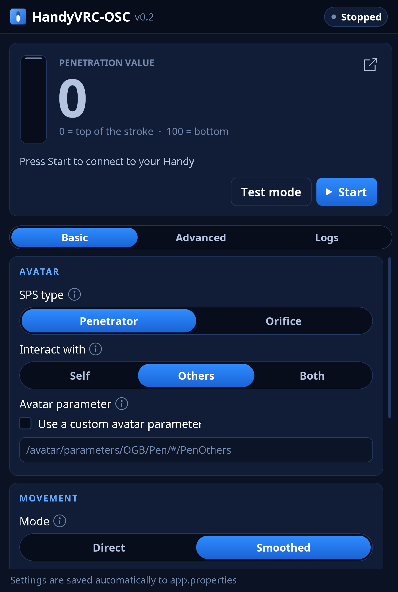

# HandyVRC-OSC

TheHandy stroker and VRChat integration via OSC and Bluetooth.



## What you need

* A **Handy** updated to [Firmware 4](https://intercom.help/ohdoki/en/articles/9457625-how-to-update-from-firmware-3-to-firmware-4)
* **Bluetooth** on your PC (the app connects to the Handy over Bluetooth)
* An avatar with **SPS**
* **OSC enabled** in VRChat (Action menu → Options → OSC → Enabled)

## Getting started

1. Download the newest version from the [Releases page](https://github.com/MocchiKon/HandyVRC-OSC/releases):
   * **Windows:** `HandyVRC-OSC-…-windows.zip`. Everything is included, nothing else to install.
   * **Other systems:** `HandyVRC-OSC-…-all-platforms.zip`. Needs [Java 21](https://adoptium.net/) or newer.
2. Unzip it anywhere and open **HandyVRC-OSC.exe** (or **HandyVRC-OSC.jar**).
3. Under **SPS type**, pick whether your avatar has a **Penetrator** or an **Orifice**.
4. Under **Interact with**, pick who moves the Handy: **Others** (other players), **Self** (your own body) or
   **Both**.
5. Turn on your Handy and press **Start**. That's it, go into VRChat.

## Tips

* Use the **full stroke range** if you can. A very short range makes slow movements hard for the Handy.
* Perform movements towards the base, positioning during act is very important due to how SPS works.

## Something doesn't work?

* **The number doesn't move:** make sure OSC is enabled in VRChat. If it's the first time you use this version,
  restart VRChat once.
* **Still nothing:** open the **Logs** tab and look for what went wrong, or turn off **Use OSCQuery** on the
  Advanced tab.
* **The Handy doesn't connect:** check that Bluetooth is on and the Handy is on Firmware 4.

If you're stuck or have feedback, please [open an issue](https://github.com/MocchiKon/HandyVRC-OSC/issues).

## Building from source

For developers. You only need **JDK 21** or newer. The Maven wrapper (`mvnw`) downloads the right Maven version
on its own. On Windows, use `mvnw.cmd` instead of `./mvnw`.

```
./mvnw package
```

Builds `target/HandyVRC-OSC-<version>.jar` and `target/HandyVRC-OSC.exe`. The `.exe` on its own needs a `jre`
folder next to it, so use the release build below to get one you can run.

### Release build

```
./mvnw package -PpackageForRelease
```

Creates the two zips for a GitHub release in `target/`, each with a `HandyVRC-OSC` folder and the default
`app.properties`:

* `HandyVRC-OSC-<version>-windows.zip`: `HandyVRC-OSC.exe` with a bundled Java runtime
  ([Temurin](https://adoptium.net/) 21). It's downloaded on the first build and cached in your Maven repository.
* `HandyVRC-OSC-<version>-all-platforms.zip`: `HandyVRC-OSC.jar`, needs Java 21 or newer installed.

Add `-DskipTests` to either command to skip the tests. The version comes from `pom.xml`. To ship a newer Java
runtime, change the `windowsJre.*` properties there.
